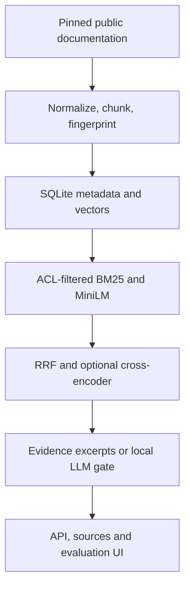

> 2026-11-06 lexical-abstention correction: see [CORRECAO_LEXICAL.md](CORRECAO_LEXICAL.md) for the policy, recorded evidence and reproduction steps. The subsequent exact-citation correction passed 23 tests on both Linux and Intel macOS.

# Enterprise RAG & AI Evaluation Platform

Retrieve public engineering documentation using BM25, vector and hybrid search. The FastAPI application returns exact source excerpts with document digests and offsets.

**Local evidence.** On Intel macOS, 23 tests passed and the hashing profile indexed 655 chunks from 12 documents. Each strategy abstained on all four negative development queries. [Run record](evidence/citation-dedup-20261109/mac-run/result.json).

## 1. Problem Statement

Answer technical-documentation questions with traceable evidence and measured retrieval quality. The system supports deterministic evidence excerpts and a small local language model whose output must pass an exact-source gate. It refuses unsupported generated text and falls back to evidence excerpts.

## 2. Architecture



SQLite uses explicitly closed per-operation connections and rollback journals. The corpus rebuild validates a fresh database before atomic publication, preserving the prior file as a backup. SQLite stores normalized exact-span offsets, document SHA256, license, tenant and normalized vector blobs. Exact cosine search is suitable for the measured small corpus. This is not a pgvector deployment or approximate-nearest-neighbor scale claim.

## 3. Tech Stack

Python, FastAPI, SQLite, BM25, MiniLM sentence embeddings, RRF hybrid search, optional MS MARCO cross-encoder, local FLAN-T5-small, pytest. Orchestration is explicit Python, with no unnecessary agent framework. Optional Ollama integration exists separately and was **not executed**.

## 4. Dataset & Data Provenance

Twelve public technical documents from scikit-learn **1.6.1** and CPython **3.12.8**, with source URLs, licenses and SHA256 in `data/corpus/manifest.json`. The pipeline document resolves the upstream `compose.rst` content rather than an empty include stub. Scikit-learn docs retain BSD-3-Clause attribution; Python docs retain PSF-2.0 terms, with upstream license files saved alongside the corpus. No private document or paid source is required. Model identifiers/revisions are in `evidence/model_revisions.json`; downloaded weights are kept outside version control.

## 5. Setup & Installation

Validated platforms are Linux x86_64 with Python 3.12 and Intel macOS with Python 3.13 for the hashing profile. Windows/WSL remains untested. From this repository directory:

```bash
bash scripts/setup.sh
source .venv/bin/activate
```

Direct dependencies are pinned in `requirements-portfolio.txt`. `requirements-lock.txt` records the tested Linux dependency closure. CPU PyTorch is installed first by the setup script where needed. Large data and model weights are fetched from their public providers; first execution requires internet access. No paid API key or cloud billing is required.

## 6. Running Locally

```bash
python -m rag_platform.demo --download --model sentence-transformers/all-MiniLM-L6-v2
EMBED_MODEL=sentence-transformers/all-MiniLM-L6-v2 python -m uvicorn rag_platform.api:app --host 127.0.0.1 --port 8001
```

Optional measured comparisons: `python -m rag_platform.compare --rerank` and `python -m rag_platform.compare --local-llm`.

Open `http://127.0.0.1:8001/` for the functional search/citation/evaluation UI. The default query API is evidence-extractive. Set `ENABLE_LOCAL_LLM=1` after preparing `google/flan-t5-small`, and send query `mode: local-llm` to use the local generator with exact-source verification. A rejected generation falls back rather than exposing unsupported prose. No external LLM API is used.

`Store.upsert()` atomically replaces all chunks of a document; `Store.delete()` removes metadata and vectors transactionally. The delete API requires `RAG_ADMIN_TOKEN`. Public queries are anonymous; private tenant identities require a server-configured `RAG_TENANT_TOKENS` JSON map and `X-Tenant-Token`. A user cannot grant access by choosing a tenant label. Keep the application on localhost unless an audited authentication gateway is added.

## 7. Testing

```bash
python -m pytest -q
python -m ruff check rag_platform tests/test_pro_rag.py scripts/load_api.py
EMBED_MODEL=sentence-transformers/all-MiniLM-L6-v2 python scripts/load_api.py --module rag_platform.api:app
```

Tests validate exact quote spans, ACL filtering before search, document replacement/removal, malicious-document quarantine, adversarial queries, admin authorization, strict request/resource limits, invalid sources and unsupported-generator fallback. They are a bounded threat test set, not a complete prompt-injection defense certification.

The query endpoint emits an exact excerpt once per document version, even when overlapping chunks retrieve it multiple times. Identical excerpts from different documents retain their own citations. Raw search still exposes the original ranked chunks. The regression test checks citation IDs and offsets against the indexed text.

The 2026-11-09 hashing validation on Linux passed 23 tests and nine localhost HTTP probes on the 12-document corpus. The SQLite query reproduced the original duplication under all three retrieval strategies. Vector retrieval went from two identical citations to one. Results and environment versions are in `evidence/citation-dedup-20261109/`. This run covers exact duplicates.

## 8. Performance Results

`evidence/retrieval_evaluation.json` compares lexical, vector and hybrid retrieval on **12 manually authored development queries** and four negative/adversarial queries. `evidence/retrieval_neural_reranking.json` records the executed cross-encoder comparison. These are small development sets, not unbiased held-out generalization evidence. On that set, neural reranking obtained Recall@5/MRR of 1.0; no claim is made beyond those queries. Exact-quote checks establish provenance, not semantic completeness or universal factuality. Latency includes retrieval/encoding, with separate actual HTTP load results.

`evidence/generative_api.json` also records an actual HTTP query with local generation enabled and a verified source-span answer. `evidence/local_llm.json` records four local generation cases. One generated source span was accepted and other generations used the evidence fallback; the malicious instruction query was rejected. API cost per query is zero because no paid external call is made; CPU/energy/hosting cost is not estimated.

## 9. Engineering Decisions

Source text is data, never executable instruction. Detectable instruction patterns are quarantined, and the default output is selected source text rather than free-form claims. Generative output requires exact substring support in an authorized retrieved chunk, accepting reduced fluency in exchange for verifiable provenance. The cross-encoder is optional to expose its latency/quality tradeoff. A lightweight hashing vector baseline is explicitly labeled lexical hashing, not semantic intelligence. The neural MiniLM path is the measured semantic path.

## 10. Failure Handling

Insufficient evidence triggers abstention. Missing/disabled local generation returns a clear configuration error. Unsupported generated text triggers fallback. Parameterized SQL avoids injection; source URLs must use HTTPS; user-controlled URLs are not fetched by the query API. Query/chunk/document budgets and an in-process rate limit bound local resource use. Model remote code is disabled. SQLite document replacement is transactional; read operations filter access before scoring. `/metrics` and structured logs contain operational fields without raw documents, queries or tokens.

## 11. Limitations

Browser-rendering automation was unavailable; JavaScript syntax, static routes and API behavior were checked, and no browser screenshot is claimed. No universal prompt-injection protection, semantic factuality guarantee, independent human evaluation or distributed rate limiting is claimed. Corpus formats are UTF-8 RST/text; PDF extraction/OCR is not implemented. Exact vector scans, rebuilding lexical statistics per query and local-model inference limit concurrency. Authentication configuration is a local demonstration, not enterprise identity federation. Native pgvector, background ingestion jobs, LLM synthesis with semantic entailment verification and Ollama runtime remain pending or optional. No cloud deployment was performed.

## 12. Future Improvements

Expand and freeze a blind relevance set; annotate answer completeness and entailment; evaluate chunk-level relevance and adversarial document variants; validate more local generator questions; introduce pgvector only when measured corpus scale justifies it; integrate audited identity and distributed limits before external hosting.


## Intel Mac local profile

Current official PyTorch packages do not provide Intel macOS wheels. `scripts/setup.sh` therefore installs `requirements-local.txt` on Intel macOS. The full `requirements-portfolio.txt` continues to include sentence-transformers and PyTorch on supported platforms; no neural implementation was removed.

```bash
bash scripts/setup.sh
source .venv/bin/activate
python -m pytest -q
python -m rag_platform.demo --model hashing
export EMBED_MODEL=hashing
python -m uvicorn rag_platform.api:app --host 127.0.0.1 --port 8001
```

Open http://localhost:8001. This profile provides real document ingestion, BM25, hashed text vectors, hybrid retrieval, source-linked extractive answers, ACLs and evaluations. HashingVectorizer is a lexical baseline, **not a learned semantic embedding model**. It does not validate MiniLM, the neural reranker or FLAN-T5 on the Mac. Do not set ENABLE_LOCAL_LLM=1 in this profile. Full neural comparisons remain available on a supported PyTorch platform.

On Intel macOS with Python 3.13, 23 tests passed in 7.64 s, the hashing index built 655 chunks from 12 documents, and all three strategies abstained on the four negative development queries. The user-supplied browser export shows three distinct SQLite excerpts. Each was checked against the source digest and exact offsets. The export records the rendered answer and citations. The selected retrieval strategy and a rendered abstention are outside its scope. See `evidence/citation-dedup-20261109/mac-run/result.json`.


## Source-span evidence policy (2026-11-06)

Each extractive citation now requires at least 40% coverage of query content terms, at least two matching terms (one for a single-term query), and every explicit query numeric literal in that same span. Contractions are preserved rather than matching `won` inside `won't`. Raw retrieval remains available for inspection. The generation entry point receives only approved spans and skips the generator when none qualify.

This is a conservative lexical heuristic, not a semantic entailment guarantee. On the original 12-positive/4-negative development set with hashing, lexical answered 12/12 positives and abstained on 4/4 negatives (previously 3/4). Vector and hybrid answered 11/12 positives and abstained on 4/4 negatives. On the separate hand-authored regression probes, the three strategies abstained on 8/8 negatives; positive-answer counts were 6/8, 5/8 and 6/8 respectively. False abstentions remain visible in the reports. These are development results, not an independent quality benchmark.

The provenance metric no longer treats an empty citation list as a verified quote. Its denominator remains all positive queries, so abstentions lower that metric. The neural/LLM models were not rerun in this correction. No source corpus, license or model implementation was replaced. Reproduce the additional probes with `python -m rag_platform.abstention_regression` after indexing. The current evidence is in the dated `lexical_*20261106` files.
